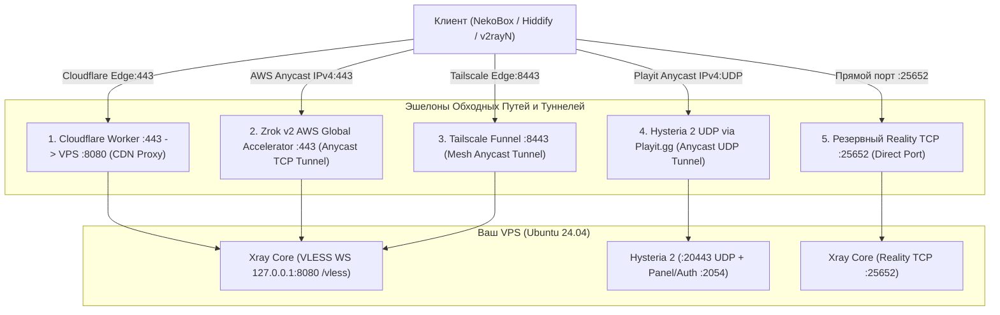

# Multi-Echelon VPS Network Kit (0-Cost Edition)
> **Схема 100% бесплатного обхода блокировки IPv4 вашего VPS провайдерами и сетевыми фильтрами**

[](#)
[](#)
[](#)
[](#)

> [!NOTE]
> **От автора (by darenN):**  
> *Данные действия протестированы лично мной, обходы искал с июня 2026 года, данные обходы не нашел в свободных источниках, все решения и победы достиг с помощью бесплатных подписок на ИИ.*

`vpn` • `vps-bypass` • `reverse-proxy` • `reverse-tunnel` • `tunneling` • `vless-reality` • `hysteria2` • `xray-core` • `3x-ui` • `cloudflare-workers` • `zrok2` • `tailscale-funnel` • `playit-gg` • `anycast` • `обход-блокировок` • `бесплатный-vpn` • `туннелирование` • `обратный-прокси`

---

## 🔍 Для кого этот проект (Популярные проблемы и решения)

Если вы искали решение по любому из этих запросов — этот репозиторий полностью решает вашу проблему:

- **"Заблокировали IP адрес VPS сервера что делать"** — автоматический переход на Anycast CDN / релеи (Cloudflare / Zrok / Tailscale / Playit).
- **"Перестал работать Reality / VLESS / Shadowsocks"** — обход сетевых фильтров через WebSocket и обратные туннели.
- **"Провайдер заблокировал VPS / подсеть хостинга"** — маскировка за дата-центрами Amazon AWS, Cloudflare и Tailscale.
- **"Как сделать свой бесплатный VPN без бана"** — пошаговый подъем с нуля за 15 минут.
- **"Провайдер глушит UDP / WireGuard / OpenVPN"** — протокол Hysteria 2 через Playit.gg пробивает любые ограничения.
- **"Бесплатный reverse proxy туннель"** — Zrok v2, Cloudflare Workers, Tailscale Funnel.
- **"Не работает Ютуб / Дискорд / Инстаграм на своем сервере"** — готовые профили для NekoBox и Hiddify.

---

<details>
<summary><b>Показать полный список ключевых поисковых тегов (SEO Keywords)</b></summary>

### Поисковые запросы на русском:
`vpn`, `впн`, `бесплатный vpn`, `свой vpn`, `обход блокировок`, `обход блокировки vps`, `заблокировали vps`, `бан ip vps`, `блокировка ютуб`, `обход блокировки discord`, `дискорд vpn`, `youtube vpn`, `не работает vless`, `reality заблокировали`, `как обойти блокировку vps`, `туннель для vpn`, `обратный прокси`, `бесплатный прокси`, `cloudflare vless worker`, `zrok vpn`, `playit vpn`, `tailscale funnel vpn`, `hysteria 2 настройка`, `3x ui настройка`, `nekobox настройка`, `hiddify настройка`, `прокси для россии`, `любой провайдер`

### International / Global English Search Queries:
`free-vpn`, `vps-ban-bypass`, `unblock-vps`, `free-reverse-proxy`, `free-tunnel`, `vless`, `vless-reality`, `hysteria2`, `xray`, `xray-core`, `3x-ui`, `sing-box`, `nekobox`, `hiddify`, `cloudflare-worker-vless`, `zrok-tunnel`, `tailscale-funnel-proxy`, `playit-gg-tunnel`, `udp-tunneling`, `quic-proxy`, `shadowsocks-blocked`, `isp-blocking`, `dpi-bypass`

</details>

---

## 🚀 Архитектура: 5 Эшелонов Доступа (без конфликтов портов)

Система объединяет 5 независимых уровней доставки трафика с **разделёнными портами и единым локальным бэкендом Xray (`127.0.0.1:8080`)**. При блокировке прямого IP или любого из каналов трафик мгновенно переключается на остальные эшелоны:



### Сводная таблица эшелонов

| Эшелон | Протокол | Внешний порт | Локальный вход VPS | Защита от блокировки | Стоимость | Назначение |
|---|---|---|---|---|---|---|
| **1. Cloudflare Worker** | VLESS WS | `:443` (CF CDN) | Xray WS `:8080` (`/vless`) | IP VPS скрыт за сетью Cloudflare | $0 | Обход бана IP через Edge Relay |
| **2. Zrok v2 AWS Tunnel** | VLESS WS | `:443` (AWS ALB) | Xray WS `127.0.0.1:8080` | Трафик идёт через Amazon Global Accelerator | $0 | Надёжный Anycast TCP резерв |
| **3. Tailscale Funnel** | VLESS WS | **`:8443`** | Xray WS `127.0.0.1:8080` | Трафик идёт через дата-центры Tailscale | $0 | Белый домен с Let's Encrypt без WireGuard на клиенте |
| **4. Playit.gg Hysteria** | Hysteria 2 (QUIC) | Playit UDP `:PORT` | Hysteria `:20443` UDP | Обход бана IP и блокировок UDP/NAT | $0 | Звонки (Discord/TG), игры, плохой интернет |
| **5. Резервный Direct** | VLESS Reality | `:25652` | Xray Reality `:25652` | Маскировка под Sony TLS (`sony.com`) | $0 | Прямой резервный канал |


> [!IMPORTANT]
> **Почему Tailscale Funnel вынесен на порт `8443` (а не `443`):**  
> При запуске `tailscale funnel --bg --https=443 ...` демон `tailscaled` занимает порт `443` на интерфейсе `tailscale0` (`100.x.y.z:443`). Если в 3X-UI инбаунд `443` слушает все интерфейсы по умолчанию (`0.0.0.0:443`), Xray падает с ошибкой **`bind: address already in use`** и Stealth Reality перестаёт работать (а перенос Stealth на нестандартный порт вроде `444` ломает логику маскировки под Apple:443).  
> * По умолчанию в этом комплекте **Stealth Reality забирает настоящий `443`**, а **Tailscale Funnel работает на официальном порту `8443`** (`443`, `8443`, `10000` разрешены в Tailscale).  
> * *Если вам принципиально нужны ОБА сервиса на `443`:* в 3X-UI у инбаунда `443-reality` задайте в поле **`Listen`** конкретный IP сетевого интерфейса VPS (`ip -4 route get 1.1.1.1`) вместо пустого `0.0.0.0` — тогда Xray сядет на `eth0/ens3:443`, а Tailscale на `tailscale0:443`, и конфликта сокетов не будет.

---

## 🛠️ Быстрый старт на чистом сервере

Требования: Ubuntu 20.04 / 22.04 / 24.04, 1 vCPU, 1 GB RAM.

```bash
git clone https://github.com/darenn46-cloud/AntiBlock_IPv4_VPS_Free.git /opt/vps-bypass-kit
cd /opt/vps-bypass-kit/scripts
chmod +x setup_server.sh
sudo ./setup_server.sh
```

Скрипт автоматически:
1. Включает TCP BBR и создаёт 1 GB Swap.
2. Устанавливает **3X-UI** (Xray Core).
3. Устанавливает **Hysteria 2**, генерирует TLS-сертификат, копирует `config.yaml` и веб-панель `/opt/hysteria-panel/app.py`.
4. Скачивает **zrok2**, **Playit.gg** и **Tailscale**.
5. Копирует systemd-шаблоны из `configs/systemd/` и настраивает правила `ufw`.

---

## ⚙️ Пошаговая настройка каждого эшелона

### Эшелон 1: VLESS Reality Stealth (Порт 443 + резерв 25652)
- Откройте панель 3X-UI (`https://<YOUR_VPS_IP>:2053`) и импортируйте схему из [`configs/3x-ui-inbounds-template.json`](configs/3x-ui-inbounds-template.json).
- **Inbound #1 (`inbound-443-reality`):** Port `443`, Protocol `VLESS`, Security `Reality`, Dest `gateway.icloud.com:443`, `flow: ""` (пусто для совместимости).
- **Inbound #2 (`inbound-25652-reality-backup`):** запасной Reality-канал на нестандартном порту (`sony.com:443`).
- **Inbound #3 (`inbound-8080-ws`):** Port `8080`, Protocol `VLESS`, Network `ws`, Path `/vless`, Security `none` — единая точка входа для Эшелонов 2, 3 и 4.
- **Важно для клиента (NekoBox / sing-box / xray-core):** если при `fp=chrome` на `gateway.icloud.com` возникает сбой рукопожатия (постквантовый TLS в новых версиях `xray.exe`), переключите `fp` на `ios` или `edge` (либо используйте `sing-box`).

### Эшелон 2: Cloudflare Worker + VLESS WS (Порт 8080)
- 📖 **Подробная инструкция:** [`docs/CLOUDFLARE_WORKER_GUIDE.md`](docs/CLOUDFLARE_WORKER_GUIDE.md)
1. В Cloudflare создайте Worker с рабочим кодом из [`configs/cloudflare-worker.js`](configs/cloudflare-worker.js) *(использует нативный `cloudflare:sockets` для прямого WebSocket-моста к вашему VPS без стороннего домена)*.
2. Задайте переменные окружения (`Settings -> Variables`): `VPS_HOST` (ваш IPv4 VPS), `VPS_PORT` (`8080`), `WS_PATH` (`/vless`).
3. На клиенте указывайте `Address`: чистый IPv4 Cloudflare (`104.16.1.1`), `Port`: `443`, `SNI`/`Host`: `<WORKER>.<SUB>.workers.dev`, `Path`: `/vless`.

### Эшелон 3: Zrok v2 AWS Anycast Tunnel (Порт 8080 -> 443)
- 📖 **Подробная инструкция:** [`docs/TAILSCALE_ZROK_GUIDE.md`](docs/TAILSCALE_ZROK_GUIDE.md)
1. Зарегистрируйтесь на [zrok.io](https://zrok.io) / [myzrok.io](https://myzrok.io) и активируйте сервер:
   ```bash
   zrok2 enable <YOUR_ZROK_TOKEN>
   sudo systemctl enable --now zrok2-tunnel
   ```
2. Узнайте публичный адрес `<ID>.shares.zrok.io` (`journalctl -u zrok2-tunnel -n 30`) и его Anycast IPv4 (через `dig +short <ID>.shares.zrok.io`).
3. **В клиентах (NekoBox / Hiddify):**
   - `Address`: Anycast IPv4 AWS (вместо домена, чтобы избежать ошибки IPv6 на Windows), `Port`: `443`, `TLS`: `true`, `ALPN`: `http/1.1`.
   - `SNI` и `Host`: `<ID>.shares.zrok.io`, `Path`: `/vless`.
   - Для **Hiddify** обязательно добавьте HTTP-заголовок `"skip_zrok_interstitial": "true"` (иначе браузерный User-Agent Hiddify получит HTML-заглушку `HTTP 200 OK` вместо WebSocket `101`).

### Эшелон 4: Tailscale Funnel (Порт 8080 -> 8443)
- 📖 **Подробная инструкция:** [`docs/TAILSCALE_ZROK_GUIDE.md`](docs/TAILSCALE_ZROK_GUIDE.md)
1. Зарегистрируйтесь на [tailscale.com](https://tailscale.com), включите **MagicDNS** и **Funnel** в ACL админки.
2. Авторизуйте VPS и запустите проброс на порт `8443` (не трогая `443`!):
   ```bash
   sudo tailscale up --authkey=<YOUR_TAILSCALE_KEY>
   sudo tailscale funnel --bg --https=8443 http://127.0.0.1:8080
   ```
   *(Не используйте синтаксис `tcp://` — для WebSocket Xray требуется HTTP-проксирование на `http://127.0.0.1:8080`!)*
3. **На клиенте (NekoBox):**
   - `Address`: **Anycast IPv4** вашего нода (`dig +short <NODE>.<TAILNET>.ts.net`, например из подсети `185.40.234.x`) — либо домен `<NODE>.<TAILNET>.ts.net` при **Domain Strategy = `ipv4_only`**.
   - `Port`: **`8443`**, `TLS`: `true`, `ALPN`: `http/1.1`.
   - `SNI` и `Host`: `<NODE>.<TAILNET>.ts.net`, `Path`: `/vless`.

### Эшелон 5: Hysteria 2 + Playit.gg (Anycast UDP Relay)
- 📖 **Подробная инструкция:** [`docs/PLAYIT_SETUP_GUIDE.md`](docs/PLAYIT_SETUP_GUIDE.md)
1. Настройте секреты в `/etc/hysteria/config.yaml` и `/etc/systemd/system/hysteria-panel.service`, затем запустите сервисы:
   ```bash
   sudo playit setup
   sudo systemctl enable --now hysteria-server hysteria-panel playit
   ```
2. В панели Playit.gg выберите **строго `Custom` -> `UDP`** (НЕ Minecraft / Terraria!), Local Port `20443`.
3. В клиенте укажите **числовой IPv4 Playit** (`147.185.x.x:<PORT>`), `SNI: bing.com`, `insecure: true`, `Hop Interval: 0`.

---

## ⚠️ Частые ошибки и их решение

1. **`connectex: The requested address is not valid in its context` (`WinSock 10049`) в Windows/NekoBox:**
   - **Причина:** В вашей сети Windows нет рабочего IPv6, но домены туннелей (`*.ts.net`, `*.shares.zrok.io`, `*.tun.ply.gg`, `*.workers.dev`) отдают `AAAA`-записи IPv6. Настройка «Маршрутизация -> Стратегия IPv4» в NekoBox действует только на сайты *внутри* VPN, а не на подключение к самому серверу.
   - **Фикс:** В свойствах профиля в NekoBox переключите **`Domain Strategy` -> `IPv4 Only`** либо впишите в поле `Address` прямой **IPv4-адрес шлюза**, оставив домен в `SNI` и `Host`.
2. **`bind: address already in use` при запуске Xray на порту 443:**
   - **Причина:** Tailscale Funnel запущен с `--https=443`, заняв `tailscale0:443`.
   - **Фикс:** Переведите Tailscale Funnel на `--https=8443` (`sudo tailscale funnel reset && sudo tailscale funnel --bg --https=8443 http://127.0.0.1:8080`), либо явно пропишите IP сетевого интерфейса VPS в поле `Listen` инбаунда `443` в 3X-UI.

---

## 🔒 Безопасность и конфиденциальность

- Все конфигурации в репозитории обезличены — перед запуском в продакшене замените шаблонные пароли, UUID и секреты в `hysteria-config.yaml` и `hysteria-panel.service`.
- Всегда используйте фаервол (`ufw`), ограничивайте доступ к панелям (`2053`, `2054`).
- Репозиторий предназначен для резервного копирования и автономного развертывания.
