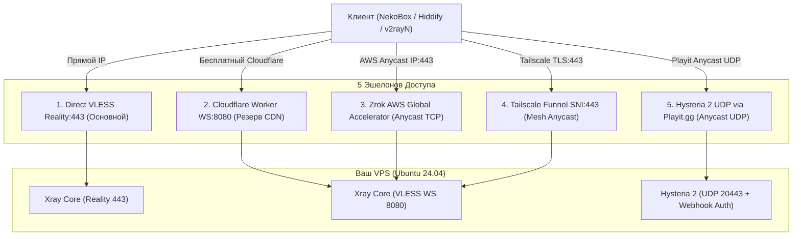

# Multi-Echelon Anti-Censorship VPS Bypass Kit (0-Cost Edition)
> **Схема 100% бесплатного обхода блокировки IPv4 вашего VPS провайдерами и ТСПУ (РКН)**

[](#)
[](#)
[](#)
[](#)
[](#)

> [!NOTE]
> **От автора (by darenN):**  
> *Данные действия протестированы лично мной, обходы искал с июня 2026 года, данные обходы не нашел в свободных источниках, все решения и победы достиг с помощью бесплатных подписок на ИИ.*

`vpn` • `anti-censorship` • `bypass-censorship` • `vps-bypass` • `reverse-proxy` • `reverse-tunnel` • `tunneling` • `vless-reality` • `hysteria2` • `xray-core` • `3x-ui` • `cloudflare-workers` • `zrok` • `tailscale-funnel` • `playit-gg` • `anycast` • `tspu-bypass` • `rkn-bypass` • `обход-блокировок` • `бесплатный-vpn` • `туннелирование` • `обратный-прокси`

---

## 🔍 Для кого этот проект (Популярные проблемы и решения)

Если вы искали решение по любому из этих запросов — этот репозиторий полностью решает вашу проблему:

- **"Заблокировали IP адрес VPS сервера что делать"** — автоматический переход на Anycast CDN (Cloudflare / Zrok / Playit).
- **"Перестал работать Reality / VLESS / Shadowsocks"** — обход ТСПУ блокировок через WebSocket и туннели.
- **"РКН заблокировал VPS / подсеть хостинга"** — маскировка за дата-центрами Amazon AWS, Cloudflare и Tailscale.
- **"Как сделать свой бесплатный VPN без бана"** — пошаговый подъем с нуля за 15 минут.
- **"Провайдер глушит UDP / WireGuard / OpenVPN"** — протокол Hysteria 2 через Playit.gg пробивает любые ограничения.
- **"Бесплатный reverse proxy туннель для обхода блокировок"** — Zrok, Cloudflare Workers, Tailscale Funnel.
- **"Не работает Ютуб / Дискорд / Инстаграм на своем сервере"** — готовые профили маршрутизации для NekoBox и Hiddify.

---

<details>
<summary><b>Показать полный список ключевых поисковых тегов (SEO Keywords)</b></summary>

### Поисковые запросы на русском:
`vpn`, `впн`, `бесплатный vpn`, `свой vpn`, `обход блокировок`, `обход блокировки vps`, `заблокировали vps`, `бан ip vps`, `тспу`, `ркн`, `блокировка ютуб`, `обход блокировки discord`, `дискорд vpn`, `youtube vpn`, `не работает vless`, `reality заблокировали`, `как обойти блокировку vps`, `туннель для vpn`, `обратный прокси`, `бесплатный прокси`, `cloudflare vless worker`, `zrok vpn`, `playit vpn`, `tailscale funnel vpn`, `hysteria 2 настройка`, `3x ui настройка`, `nekobox настройка`, `hiddify настройка`, `прокси для россии`, `антицензура`, `white list обход`, `любой провайдер`

### International / Global English Search Queries:
`free-vpn`, `vps-ban-bypass`, `anti-censorship`, `censorship-circumvention`, `great-firewall-bypass`, `rkn-bypass`, `tspu-bypass`, `unblock-vps`, `free-reverse-proxy`, `free-tunnel`, `vless`, `vless-reality`, `hysteria2`, `xray`, `xray-core`, `3x-ui`, `sing-box`, `nekobox`, `hiddify`, `cloudflare-worker-vless`, `zrok-tunnel`, `tailscale-funnel-proxy`, `playit-gg-tunnel`, `udp-tunneling`, `quic-proxy`, `shadowsocks-blocked`, `iran-censorship`, `russia-censorship`, `isp-blocking`, `dpi-bypass`

</details>

---

## 🚀 Архитектура: 5 Эшелонов Доступа

Система объединяет 5 независимых уровней доставки трафика. При блокировке любого из них (или всего белого IP сервера) трафик мгновенно переключается на резервные Anycast / CDN / Mesh каналы:



### Сводная таблица эшелонов

| Эшелон | Протокол | Канал доставки | Защита от блокировки | Стоимость | Назначение |
|---|---|---|---|---|---|
| **1. Direct Reality** | VLESS Reality | Прямой IP:443 | Маскировка под чужой TLS SNI | $0 | Максимальная скорость и низкий пинг |
| **2. Cloudflare Worker** | VLESS WS | Бесплатный воркер CF | IP вашего сервера скрыт за CDN | $0 | Бесплатный CDN-прокси |
| **3. Zrok AWS Tunnel** | VLESS WS | AWS Anycast Accelerator | Обход бана IPv4 через сеть Amazon | $0 | Надежный TCP резерв |
| **4. Tailscale Funnel** | VLESS WS | Tailscale Funnel Anycast | Трафик идет через дата-центры Tailscale | $0 | Альтернативный Mesh-туннель |
| **5. Playit.gg Hysteria** | Hysteria 2 (QUIC) | Anycast UDP Relay | Обход бана UDP и пробитие любых NAT/ТСПУ | $0 | Игры, звонки, плохой интернет |

---

## 🛠️ Быстрый старт на чистом сервере

### 1. Подготовка сервера
Требования: Ubuntu 20.04 / 22.04 / 24.04, 1 vCPU, 1 GB RAM.

Склонируйте репозиторий и запустите установщик:
```bash
git clone <URL_ЭТОГО_РЕПОЗИТОРИЯ> /opt/vps-bypass-kit
cd /opt/vps-bypass-kit/scripts
chmod +x setup_server.sh
sudo ./setup_server.sh
```

Скрипт автоматически:
1. Включает TCP BBR и оптимизирует сетевой стек ядра Linux.
2. Подключает 2 GB Swap-памяти для стабильности демонов.
3. Устанавливает и настраивает **3X-UI** (Xray Core).
4. Устанавливает **Hysteria 2** с панелью управления и гибридной авторизацией.
5. Загружает клиенты туннелей: **Zrok**, **Playit.gg**, **Tailscale**.

---

## ⚙️ Пошаговая настройка каждого эшелона

### Эшелон 1: VLESS Reality (Порт 443)
- Настраивается через панель 3X-UI (`http://<YOUR_VPS_IP>:2053`).
- **Inbound:** Port `443`, Protocol `VLESS`, Security `Reality`.
- **Dest / SNI:** `gateway.icloud.com:443` (или `dl.google.com:443`).
- Клиент подключается напрямую на `<YOUR_VPS_IP>:443`.

### Эшелон 2: Cloudflare Worker + VLESS WS (Порт 8080)
- 📖 **Подробная инструкция:** См. файл [docs/CLOUDFLARE_WORKER_GUIDE.md](docs/CLOUDFLARE_WORKER_GUIDE.md)
1. В 3X-UI создается Inbound: Port `8080`, Protocol `VLESS`, Network `ws`, Path `/vless`.
2. В Cloudflare создается бесплатный Worker со скриптом из `configs/cloudflare-worker.js`.
3. Замените в воркере:
   - `PROXYIP` = чистый Cloudflare IP/домен.
   - `USER_UUID` = UUID вашего клиента.
   - `VPS_HOST` = IP или домен вашего VPS.

### Эшелон 3: Zrok AWS Anycast Tunnel (Порт 8080)
1. Зарегистрируйтесь бесплатно на [zrok.io](https://zrok.io).
2. Активируйте окружение на сервере:
   ```bash
   zrok enable <YOUR_ZROK_TOKEN>
   ```
3. Запустите сервис туннеля (шаблон в `configs/systemd/zrok2-tunnel.service`):
   ```bash
   sudo systemctl enable --now zrok2-tunnel
   ```
4. Туннель выдаст публичный адрес вида `https://<YOUR_RANDOM_NAME>.shares.zrok.io`.
5. **Важно для клиентов (Hiddify / NekoBox):**
   - Address: `52.223.10.144` (или `35.71.189.214` — IP-адреса AWS Global Accelerator).
   - Port: `443`, TLS: `true`.
   - SNI / Host: `<YOUR_RANDOM_NAME>.shares.zrok.io`.
   - Path: `/vless`.
   - HTTP Headers: `{"skip_zrok_interstitial": "true"}` (предотвращает заглушку Zrok).

### Эшелон 4: Tailscale Funnel (Порт 8080 -> 443)
1. Зарегистрируйтесь на [tailscale.com](https://tailscale.com).
2. Авторизуйте сервер:
   ```bash
   sudo tailscale up --authkey=<YOUR_TAILSCALE_KEY>
   ```
3. Включите Funnel в фоновом режиме:
   ```bash
   sudo tailscale funnel --bg 443 tcp://127.0.0.1:8080
   ```
4. В админке Tailscale включите `MagicDNS` и Funnel для вашего нода. Адрес нода будет `<NODE_NAME>.<TAILNET>.ts.net`.
5. **Важно для NekoBox:**
   - Address: `<NODE_NAME>.<TAILNET>.ts.net`, Port: `443`, TLS: `true`.
   - SNI: `<NODE_NAME>.<TAILNET>.ts.net`.
   - Path: `/vless`.
   - **Заголовок Host оставить пустым!** (Tailscale Funnel требует совпадения или отсутствия Host для WS).

### Эшелон 5: Hysteria 2 + Playit.gg (Anycast UDP Relay)
- 📖 **Подробная инструкция:** См. файл [docs/PLAYIT_SETUP_GUIDE.md](docs/PLAYIT_SETUP_GUIDE.md)
1. Сконфигурируйте Hysteria 2 (`configs/hysteria-config.yaml`):
   - Listen: `0.0.0.0:20443`.
   - Auth: HTTP Webhook на `http://127.0.0.1:2054/auth` (скрипт в `configs/hysteria-panel/app.py`).
2. Запустите Playit CLI:
   ```bash
   sudo playit setup
   ```
3. Привяжите аккаунт и создайте UDP туннель:
   - Type: `Custom UDP`.
   - Local Port: `20443`.
4. Playit выдаст выделенный Anycast хост и порт, например `auto.playit.gg:17635`.
5. В клиенте Hysteria 2 укажите:
   - Server: `auto.playit.gg:17635`.
   - SNI: домен вашего самоподписанного сертификата (или IP сервера с `insecure: true`).
   - Auth: ваши логин/пароль.

---

## 🔒 Безопасность и конфиденциальность

- Никакие приватные ключи, токены и реальные IP-адреса **не должны** публиковаться в открытом доступе.
- Всегда используйте фаервол (`ufw`), блокируйте лишние порты.
- Репозиторий предназначен для частного резервного копирования и автономного развертывания.
